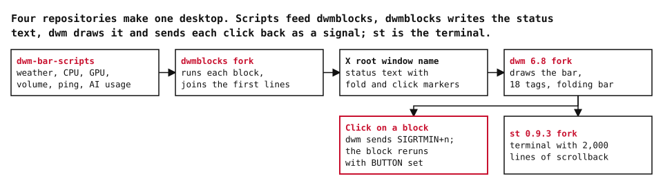

# st: terminal with scrollback

[Polski](README.pl.md)

A local fork of suckless st 0.9.3 for X11, with a 2,000-line scrollback buffer
and adjusted mouse bindings. The upstream terminal and authors remain credited
in [LICENSE](LICENSE).



## Local configuration

The tracked [config.h](config.h) is used by the build. It differs from
[config.def.h](config.def.h):

| Input | Binding in `config.h` |
|---|---|
| Mouse wheel | Scrollback, when the application is not capturing the mouse. |
| Shift + Page Up / Page Down | Scrollback by approximately one screen. |
| Middle click | Paste from the clipboard. |
| Right click | Copy selection to the clipboard. |
| Ctrl + Shift + C / V | Copy / paste. |

See [st.c](st.c) for the history buffer and the included
[scrollback](st-scrollback-0.9.2.diff) and
[mouse](st-scrollback-mouse-20220127-2c5edf2.diff) patch files for context.
The patches are already reflected in the source; do not apply them again.

## Build and run

Requires a C compiler, make, pkg-config, Xlib, Xft, Fontconfig and FreeType
headers/libraries. Installation also uses `tic` from ncurses.

```sh
make
```

Review [config.mk](config.mk) before installation. `make install` copies the
binary and manual to `/usr/local` by default and runs `tic -sx st.info`.
The terminfo step is not redirected by `DESTDIR`.

To try the built binary without a system installation, compile terminfo into a
local directory, then start the terminal from an X session:

```sh
tic -sx -o .terminfo-review st.info
TERMINFO="$PWD/.terminfo-review" ./st
```

A build does not test interactive rendering, application mouse capture or
clipboard integration. See [st.1](st.1) and [FAQ](FAQ) for usage details.

## Upstream

Based on [suckless st](https://st.suckless.org/) and Aurélien APTEL's bt source.
The MIT/X Consortium licence and original copyright notices are retained.
