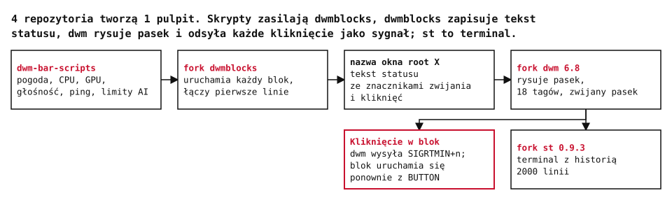

# st: terminal z historią przewijania

[English](README.md)

Lokalny fork suckless st 0.9.3 dla X11 z buforem historii na 2000 linii i zmienionymi skrótami myszy. Terminal z upstreamu i jego autorzy są wymienieni w [LICENSE](LICENSE).



## Lokalna konfiguracja

Kompilacja używa śledzonego pliku [config.h](config.h). Ten plik różni się od [config.def.h](config.def.h):

| Wejście | Działanie w `config.h` |
|---|---|
| Kółko myszy | Przewijanie historii, gdy aplikacja nie przechwytuje myszy. |
| Shift + Page Up, Shift + Page Down | Przewijanie historii o 1 ekran (wartość przybliżona). |
| Środkowy przycisk myszy | Wklejenie ze schowka. |
| Prawy przycisk myszy | Skopiowanie zaznaczenia do schowka. |
| Ctrl + Shift + C, Ctrl + Shift + V | Kopiowanie i wklejanie. |

Bufor historii jest w [st.c](st.c). Dołączone pliki łatek [scrollback](st-scrollback-0.9.2.diff) i [mysz](st-scrollback-mouse-20220127-2c5edf2.diff) służą jako kontekst. Kod źródłowy już zawiera te łatki; nie nakładaj ich ponownie.

## Budowa i uruchomienie

Wymagane są: kompilator C, make, pkg-config oraz nagłówki i biblioteki Xlib, Xft, Fontconfig i FreeType. Instalacja używa też `tic` z ncurses.

```sh
make
```

Przed instalacją przejrzyj [config.mk](config.mk). `make install` kopiuje plik wykonywalny i podręcznik domyślnie do `/usr/local` i uruchamia `tic -sx st.info`. Zmienna `DESTDIR` nie przekierowuje kroku terminfo.

Aby wypróbować zbudowany program bez instalacji w systemie, skompiluj terminfo do lokalnego katalogu i uruchom terminal z sesji X:

```sh
tic -sx -o .terminfo-review st.info
TERMINFO="$PWD/.terminfo-review" ./st
```

Kompilacja nie sprawdza interaktywnego rysowania, przechwytywania myszy przez aplikacje ani współpracy ze schowkiem. Szczegóły użycia podają [st.1](st.1) i [FAQ](FAQ).

## Upstream

Fork bazuje na [suckless st](https://st.suckless.org/) i na źródle bt autorstwa Aurélien APTEL. Licencja MIT/X Consortium i pierwotne informacje o prawach autorskich są zachowane.
