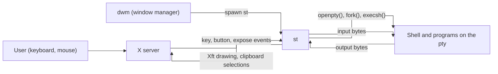
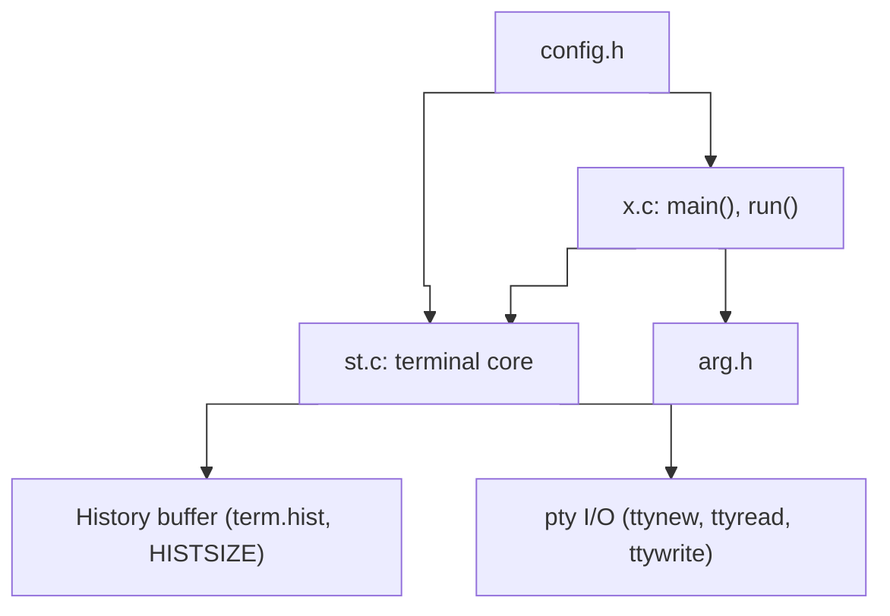
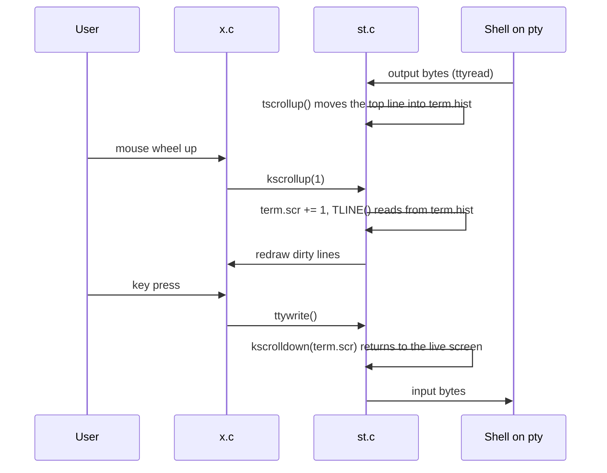

# st fork: architecture

This document describes the architecture of this st fork in the arc42 layout.
It covers the local changes on top of suckless st 0.9.3. For terminal usage,
read [st.1](../../st.1) and [FAQ](../../FAQ).

## 1 Introduction and goals

st is a terminal emulator for X11 written in C. This fork runs on one Linux
workstation and adds these functions to upstream st:

- a scrollback buffer of 2,000 lines (`HISTSIZE` in [st.c](../../st.c));
- mouse-wheel and Shift + Page Up / Page Down scrolling;
- clipboard mouse bindings: middle click pastes, right click copies.

Quality goals, in priority order:

1. A fresh clone builds the workstation configuration with `make`.
2. The applied patches stay traceable to their source diffs.
3. Scrollback adds no runtime dependency to upstream st.

## 2 Constraints

| Constraint | Evidence |
|---|---|
| C, built by `make` with flags from `config.mk`; `_XOPEN_SOURCE=600`. | [Makefile](../../Makefile), [config.mk](../../config.mk) |
| Libraries: Xlib, Xft, Fontconfig, FreeType, libutil, librt, libm; `pkg-config` finds Fontconfig and FreeType. | `LIBS` in [config.mk](../../config.mk) |
| Configuration is compiled in from `config.h`. | [Makefile](../../Makefile) |
| `make install` runs `tic -sx st.info`; this step ignores `DESTDIR`. | [Makefile](../../Makefile), [README.md](../../README.md) |
| Upstream MIT/X Consortium licence and copyright notices stay in place. | [LICENSE](../../LICENSE) |

## 3 Context and scope

st opens a pseudo-terminal, starts a shell on its slave side and draws the
terminal grid in an X window. dwm starts st from a key binding (companion
repository [dwm](https://github.com/maciejszulia/dwm)).

Out of scope: font installation, the terminfo database outside `make install`,
and the shell.

## 4 Solution strategy

- Keep the upstream split between terminal logic ([st.c](../../st.c)) and the
  X frontend ([x.c](../../x.c)).
- Apply the scrollback patches to the source and track the patch files next
  to it for provenance ([ADR 0002](adr/0002-scrollback-ring-buffer.md)).
- Track the local `config.h` in git ([ADR 0001](adr/0001-track-local-config-h.md)).
- Bind the mouse to scrollback and to the CLIPBOARD selection in `config.h`
  ([ADR 0003](adr/0003-clipboard-mouse-bindings.md)).

## 5 Building block view

| Block | File | Responsibility |
|---|---|---|
| Terminal core | [st.c](../../st.c), [st.h](../../st.h) | Escape-sequence parser, screen grid, selection, pty I/O (`ttynew()`, `ttyread()`, `ttywrite()`), history buffer. |
| X frontend | [x.c](../../x.c), [win.h](../../win.h) | `main()`, `xinit()`, `run()` event loop, drawing, keyboard and mouse mapping, clipboard. |
| Argument parsing | [arg.h](../../arg.h) | Command-line option macros. |
| Configuration | [config.h](../../config.h), [config.def.h](../../config.def.h) | Font, colours, `termname`, mouse shortcuts, key shortcuts. |
| Terminfo | [st.info](../../st.info) | Terminal capabilities compiled by `tic`. |
| Patch provenance | [st-scrollback-0.9.2.diff](../../st-scrollback-0.9.2.diff), [st-scrollback-mouse-20220127-2c5edf2.diff](../../st-scrollback-mouse-20220127-2c5edf2.diff) | Patches already applied to the source; not applied at build time. |

## 6 Runtime view

### Scrolling back and typing

`TLINE(y)` returns a line from `term.hist` when `y < term.scr`, else a line
from the live screen. Any write to the pty first scrolls back to the live
screen (`ttywrite()` in [st.c](../../st.c)).

## 7 Deployment view

`make` builds the binary `st`. `make install` copies it to
`$(DESTDIR)$(PREFIX)/bin`, installs the manual page and runs `tic -sx st.info`.
The default `PREFIX` is `/usr/local` ([config.mk](../../config.mk)). To test
without installation, [README.md](../../README.md) compiles terminfo into a
local directory and starts `./st` with `TERMINFO` set. The repository has no
CI workflow.

## 8 Crosscutting concepts

- **Compiled configuration.** All bindings and appearance settings are C
  tables in `config.h`.
- **Mouse capture.** Scrollback bindings on the wheel apply when the
  application does not capture the mouse ([README.md](../../README.md)).
- **Patch provenance.** `make dist` packs the two patch files with the
  source ([Makefile](../../Makefile)).

## 9 Architecture decisions

- [ADR 0001: Track the local config.h in git](adr/0001-track-local-config-h.md)
- [ADR 0002: Scrollback as a ring buffer in st.c](adr/0002-scrollback-ring-buffer.md)
- [ADR 0003: Clipboard mouse bindings](adr/0003-clipboard-mouse-bindings.md)

## 10 Quality requirements

| Quality | Scenario | Check |
|---|---|---|
| Buildability | `make` builds a fresh clone. | Manual; no CI workflow. |
| Scrollback | The wheel scrolls up to 2,000 lines of history. | Manual check in an X session; no automated test. |
| Clipboard | Right click copies the selection, middle click pastes it. | Manual check; [README.md](../../README.md) states that a build does not test clipboard integration. |

## 11 Risks and technical debt

- The scrollback patches change upstream code in [st.c](../../st.c); a future
  upstream update needs a manual merge.
- No CI and no automated tests; a build does not test rendering, mouse
  capture or the clipboard ([README.md](../../README.md)).
- `make install` writes terminfo outside `DESTDIR`, so a staged install
  changes the host terminfo database.

### Open questions

- None.

## 12 Glossary

| Term | Meaning |
|---|---|
| pty | Pseudo-terminal pair; st holds the master side, the shell uses the slave side. |
| Scrollback | Lines that left the top of the screen and are kept in `term.hist`. |
| `term.scr` | Number of lines the view is scrolled back from the live screen. |
| PRIMARY, CLIPBOARD | X11 selections; this fork binds the mouse to CLIPBOARD. |
| terminfo | Database of terminal capabilities; `st.info` defines `st-256color`. |
